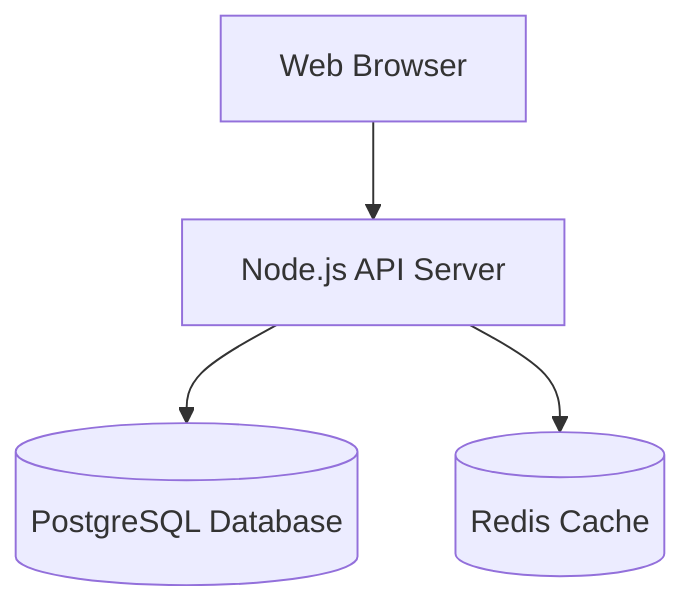

<h1 align="center">BASIC-CALCULATOR</h1>

<p align="center"><em>A FASCINITING FRONTEND OF A BASIC CALCULATOR</em></p>

<p align="center">
    
</p>

---

## 📑 Table of Contents
- [🛠️ Tech Stack](#️-tech-stack)
- [✨ Features](#-features)
- [📂 Repository Structure](#-repository-structure)
- [🏗️ Architecture Flow](#️-architecture-flow)
- [🗺️ Roadmap](#️-roadmap)
- [🎨 Custom Sections](#-custom-sections)
- [📊 📡 API Endpoint Reference](#-📡-api-endpoint-reference)
- [❓ FAQ](#-faq)

---

<details>
  <summary><b>🛠️ Tech Stack (Click to Expand)</b></summary>

## 🛠️ Tech Stack

 
</details>

<p align="right">(<a href="#-table-of-contents">back to top</a>)</p>

---

## ✨ Features

- ⚡ **High Performance**: Built for speed and efficiency.
- 🛡️ **Fully Type-Safe**: Robust structure and error handling.
- 🎨 **Clean UI/UX**: Designed for optimum user experience.


<p align="right">(<a href="#-table-of-contents">back to top</a>)</p>

---

## 📂 Repository Structure

```bash
├── src/
│   ├── components/
│   ├── pages/
│   └── styles/
├── public/
├── package.json
└── README.md
```

<p align="right">(<a href="#-table-of-contents">back to top</a>)</p>

---

## 🏗️ Architecture Flow



<p align="right">(<a href="#-table-of-contents">back to top</a>)</p>

---

## 🗺️ Roadmap

- [x] Phase 1: Core MVP Launch
- [x] Phase 2: Mobile Responsiveness
- [ ] Phase 3: Multi-language Support


<p align="right">(<a href="#-table-of-contents">back to top</a>)</p>

---

## 🎨 Design Tokens & UI Specs

BULIT USING HTML AND CSS


<p align="right">(<a href="#-table-of-contents">back to top</a>)</p>

---

## 📊 📡 API Endpoint Reference

| Endpoint | HTTP Method | Auth Required | Description |
| :--- | :--- | :--- | :--- |
| /api/v1/auth/login | POST | No | Authenticates user & returns JWT |
| /api/v1/user/profile | GET | Yes | Fetches authenticated user data |


<p align="right">(<a href="#-table-of-contents">back to top</a>)</p>

---

## ❓ FAQ

#### Is this tool free to use?
Yes, it is 100% open-source and free.


<p align="right">(<a href="#-table-of-contents">back to top</a>)</p>

---

## 📄 License

This project is unlicensed. All rights reserved.

---

<p align="center"><sub>Crafted with ❤️ for developers worldwide.</sub></p>
